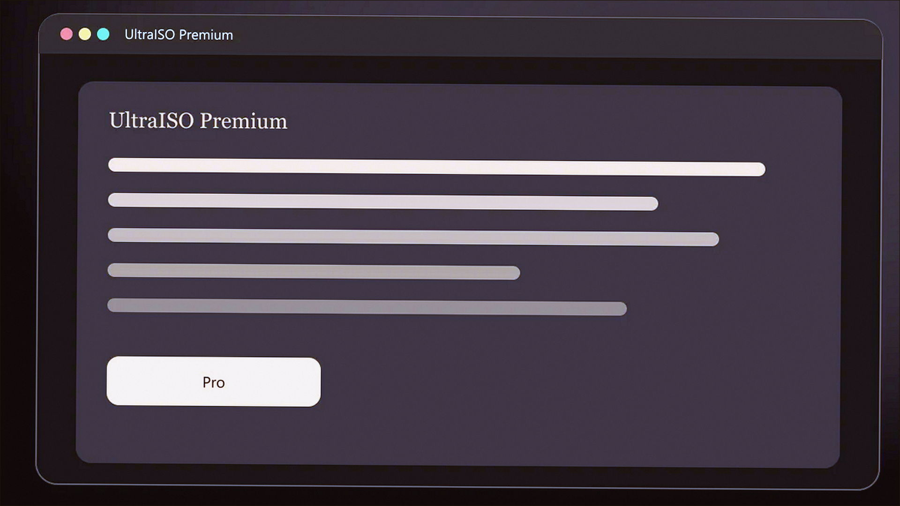
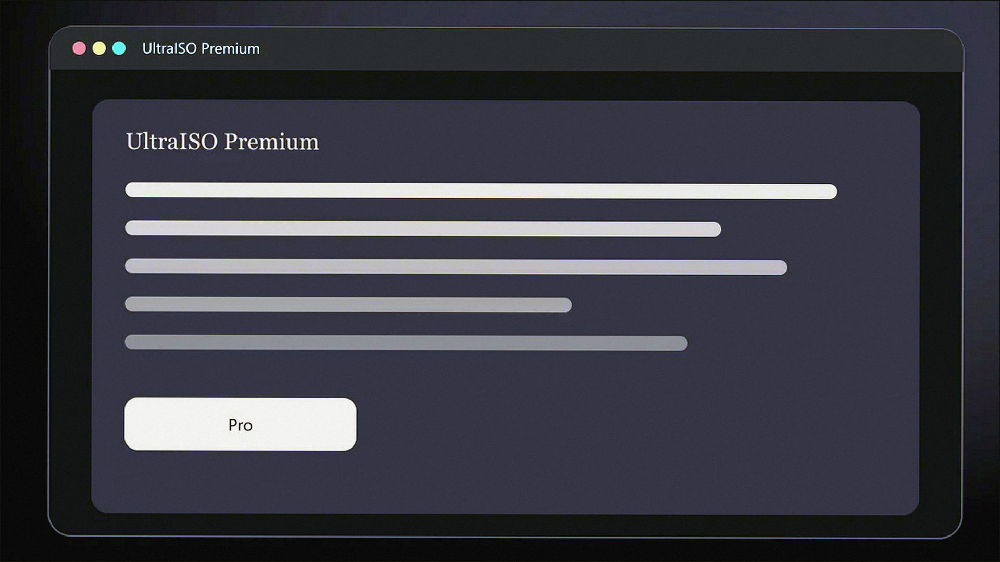
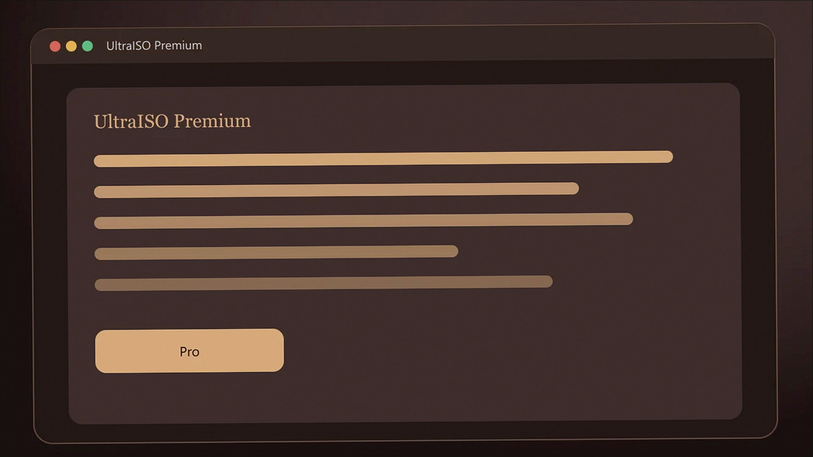

# Windows notes: UltraISO

**EZB Systems** · 9.7 · 6 MB · System catalog

[Open card](https://moggydayprogram.com/programs/ultraiso) · [English](https://moggydayprogram.com/en/programs/ultraiso) · [GitHub Pages](https://logomaidspin.github.io/ultraiso-windows/?lang=en)

  
  
  

Редактор образов. Premium, русский. PowerISO в ZIP легче.

UltraISO on Windows 10/11 x64. 6 MB. Requirements, screenshots, MoggyDay Launcher.

Get it from the catalog card, not from this repository.

| Field | Value |
| --- | --- |
| Build | 9.7.6.3860 Premium |
| OS | Windows 10/11 x64 |
| Pages | https://logomaidspin.github.io/ultraiso-windows/ |

- [PowerISO](https://moggydayprogram.com/programs/poweriso)
- [BurnAware Professional](https://moggydayprogram.com/programs/burnaware-professional)
